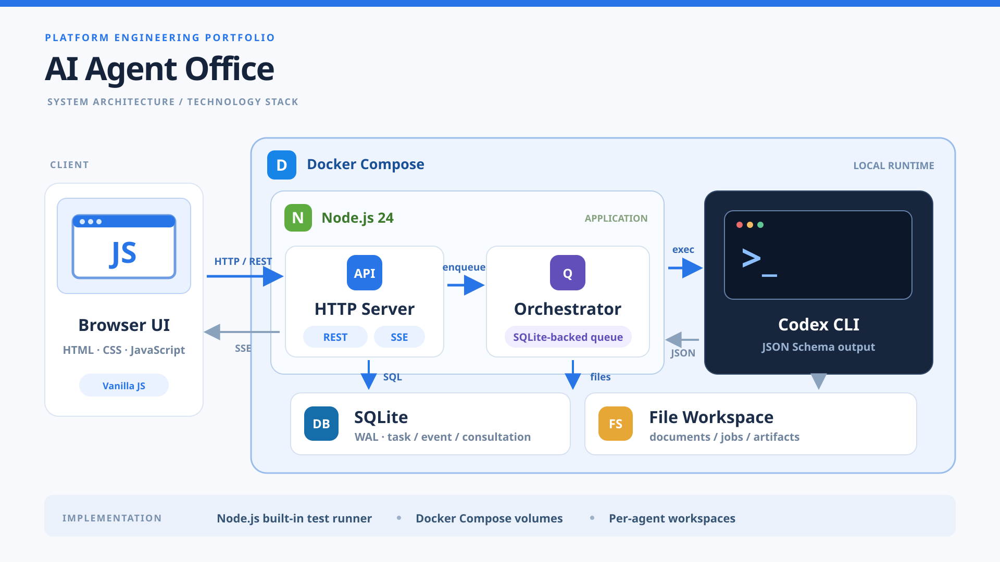

# AI Agent Office

**여러 AI 에이전트의 업무 실행 조건과 협업 과정을 관리하는 개인용 작업 환경**

## 해결하려는 문제

조사·분석·문서 작성처럼 역할을 나눠 AI 에이전트에게 맡기면, 한 업무에 여러 지침과 참고 문서, 동료의 답변이 얽힙니다. 최종 답변만 남으면 **어떤 자료를 사용했는지, 누가 어떤 판단을 보탰는지, 추가 정보가 필요해서 멈춘 것인지** 확인하기 어렵습니다. 작업을 다시 수행하거나 결과를 검토할 때 실행 맥락을 수동으로 재구성해야 하는 점이 이 프로젝트의 출발점입니다.

AI Agent Office는 이 문제를 세 가지 단위로 다룹니다.

1. **입력 맥락 관리:** 업무 목표·담당 역할·참고 문서를 함께 저장하고, 실행 시 해당 에이전트의 작업 폴더에 전달합니다.
2. **협업 과정 기록:** 담당 에이전트가 동료에게 물은 질문과 답변, 상호 검토 내용을 업무에 연결해 남깁니다.
3. **실행 상태 관리:** 완료·동료 도움 요청·추가 자료 요청을 구조화된 응답으로 구분하고, 진행 이벤트와 결과를 확인할 수 있게 합니다.

예를 들어 리서처가 자료를 검토하다 시장 규모의 해석을 분석가에게 요청하면, 질문·답변·최종 결과가 같은 업무 기록에 남습니다. 필요한 자료가 없으면 완료로 처리하지 않고 추가 자료 요청 상태를 표시합니다.



## 핵심 설계

| 과제 | 구현 |
| --- | --- |
| LLM 응답을 다음 단계로 연결 | `complete`, `needs_help`, `needs_input` JSON 스키마로 실행 결과를 구분 |
| 역할과 자료의 범위 관리 | 층·부서·에이전트별 지침과 참고 문서를 조합하고, 업무·에이전트별 작업 폴더에 문서를 전달 |
| 필요한 순간에 협업 | 담당 에이전트가 최대 2명의 동료에게 질문하고, 여러 답변이 있으면 상호 검토 후 최종 결과 작성 |
| 실행 과정 추적 | 업무 상태·이벤트·질의와 답변을 SQLite에 기록하고 SSE로 브라우저에 진행 상황 전달 |
| 서버 재시작 대응 | 실행 중이던 업무를 대기 상태로 돌려 다시 처리 |

업무는 `queued → running → completed / needs_input / failed / cancelled` 상태를 가집니다. 대기 업무는 SQLite에 저장하고, 단일 Node.js 프로세스의 워커가 순서대로 처리합니다. Codex CLI는 각 에이전트의 작업 폴더에서 실행하며, 파일 쓰기 범위를 해당 작업 공간으로 제한합니다.

참고 문서는 TXT·MD·CSV·JSON·PDF·DOCX를 받습니다. PDF와 DOCX는 실행 전에 텍스트로 추출합니다. 실제 외부 서비스 연동과 로컬 PC 파일에 대한 직접 접근은 현재 범위에 포함되지 않습니다.

## 기술 스택

- **Frontend:** HTML, CSS, Vanilla JavaScript
- **Backend:** Node.js 24 HTTP 서버, 작업 워커, Server-Sent Events
- **Agent runtime:** Codex CLI, JSON Schema 출력, 업무별 작업 공간
- **Storage:** SQLite WAL, 서버 파일 저장소
- **Delivery:** Docker Compose, Node.js 기본 테스트 러너, GitHub Actions

새로운 프레임워크보다 실행 흐름과 실패 상태를 직접 제어할 수 있는 작은 구성을 선택했습니다. Docker Compose는 웹앱과 데이터·Codex 인증 볼륨을 구성합니다.

## 실행

Node.js 24 이상과 [Codex CLI](https://developers.openai.com/codex/cli)가 필요합니다. 먼저 `codex login`으로 인증한 뒤 실행합니다.

```powershell
cd office
$env:OFFICE_PASSWORD = '본인만-아는-긴-비밀번호'
$env:SESSION_SECRET = '긴-무작위-세션-서명-값'
npm start
```

`http://127.0.0.1:3000`에서 접속합니다. Windows에서는 저장소 루트의 `start-office.cmd`로도 실행할 수 있습니다. Codex 인증이 없으면 등록한 업무는 대기 상태에 머뭅니다.

Docker로 실행할 때는 `office/.env.example`을 `office/.env`로 복사해 비밀번호와 세션 서명 값을 설정합니다.

```sh
cd office
docker compose up -d --build
docker compose exec office codex login --device-auth
docker compose restart office
```

앱은 기본적으로 로컬 주소에만 공개됩니다. Docker 환경에서는 비밀번호와 세션 서명 값이 필수입니다. API 키 인증은 선택 사항이며 별도 API 사용 요금이 발생할 수 있습니다.

## 검증

```sh
cd office
npm test
```

테스트는 실제 모델 호출 대신 실행기를 주입해 **담당 에이전트의 동료 질의·결과 반영**과 **복수 동료의 상호 검토·기록**을 검증합니다. GitHub Actions에서 동일한 테스트를 실행합니다.

현재 테스트 범위에는 실제 Codex CLI를 호출하는 종단 간 테스트, 성능 측정, 다중 사용자 운영 검증이 포함되지 않습니다. 이 프로젝트는 개인용 실행 환경이며, 작업 처리도 단일 프로세스에서 순차적으로 진행됩니다.

## 저장소 구성

```text
office/
  server.js        HTTP API, 인증, SSE
  worker.js        작업 큐와 에이전트 협업 흐름
  codex.js         Codex CLI 실행 및 출력 스키마
  db.js            SQLite 스키마와 조회
  public/          웹 화면
  worker.test.js   협업 흐름 테스트
  Dockerfile       실행 이미지
  compose.yaml     로컬 배포
docs/
  architecture.svg
.github/workflows/test.yml
```

`office/data/`에는 실행 중 생성된 DB, 파일, 인증 정보가 저장되며 Git과 Docker 빌드 컨텍스트에서 제외됩니다.
